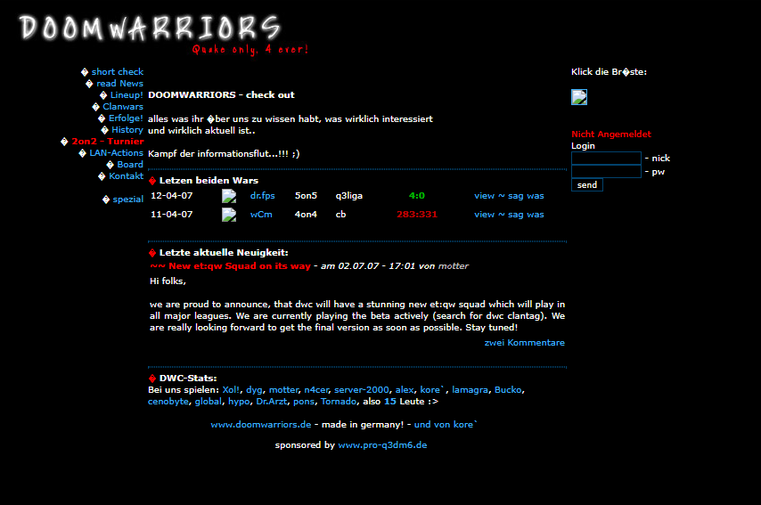

# Doomwarriors Homepage

Website for the Doomwarriors clan, featuring news, a clan-war archive, player
profiles, and the clan's history. The project is built with the Play Framework
and includes a member login with role-based administration.



## Features

- Homepage with the latest news and clan wars
- News and clan-war archives with results, maps, line-ups, screenshots, and Quake 3 demos
- Player and squad overview
- Clan history, contact page, legal notice, and privacy policy
- Video archive with an in-browser player and download links
- Download section for configs, maps, demos, and other files
- Random images served from a configurable directory
- Administration area for creating and editing news, clan wars, videos, and downloads
- Historical data initialization using Play Evolutions

## Technology

- Java and Scala 2.13
- [Play Framework 3](https://www.playframework.com/)
- Twirl templates
- Ebean ORM
- PostgreSQL
- sbt

The exact versions used by the project are defined in `build.sbt`,
`project/build.properties`, and `project/plugins.sbt`.

## Requirements

- JDK 17 or newer
- sbt 1.12 or newer
- PostgreSQL

## Local Setup

1. Clone the repository and change into the project directory.

2. Create a PostgreSQL database:

   ```sql
   CREATE DATABASE dwc;
   ```

3. Update the database connection in `conf/application.conf`. Alternatively,
   use a separate configuration file that is not committed to version control,
   such as `conf/local.conf`:

   ```hocon
   include "application.conf"

   db.default.url = "jdbc:postgresql://localhost:5432/dwc"
   db.default.username = "postgres"
   db.default.password = "my-password"

   play.http.secret.key = "a-long-random-secret-key"
   picture_folder = "C:/path/to/images"
   ```

4. Optionally bootstrap the first administrator. While no active lineup member
   holds the ADMIN role, the member whose nick is given here becomes administrator
   on startup, and the password becomes theirs if they have none yet. Once an
   administrator exists, both variables have no effect and can be removed.

   PowerShell:

   ```powershell
   $env:DWC_ADMIN_USERNAME = "your-nick"
   $env:DWC_ADMIN_PASSWORD = "a-secure-password"
   ```

   Linux/macOS:

   ```bash
   export DWC_ADMIN_USERNAME="your-nick"
   export DWC_ADMIN_PASSWORD="a-secure-password"
   ```

5. Start the application:

   ```bash
   sbt -Dconfig.file=conf/local.conf run
   ```

   If the values were configured directly in `application.conf`, run:

   ```bash
   sbt run
   ```

6. Open [http://localhost:9000](http://localhost:9000). On the first start,
   Play creates the tables and imports the historical sample data using the
   evolutions in `conf/evolutions/default`. The administration area is
   available at [http://localhost:9000/admin](http://localhost:9000/admin).

## Tests

```bash
sbt test
```

## Important Configuration

| Setting | Purpose |
| --- | --- |
| `db.default.*` | PostgreSQL connection |
| `play.http.secret.key` | Signing and session secret; always replace it in production |
| `DWC_ADMIN_USERNAME` | Nick of the member to make administrator while none exists (bootstrap only) |
| `DWC_ADMIN_PASSWORD` | That member's initial password if they have none yet (bootstrap only) |
| `picture_folder` | Directory containing images served by `/random` |
| `video_folder` | Directory containing the archive videos served by `/videos` |
| `download_folder` | Directory containing the files served by `/downloads`, and the clan-war demos in its `clanwar-demos` subfolder |
| `clanwar_demo_retention_days` | Days after which a clan-war demo file no map refers to is deleted (default 30, `0` keeps all) |
| `owner.*` | Contact and legal-notice details |
| `privacy.*` | Privacy-policy details |

Do not commit credentials or production secrets. Provide them through
environment variables or a separate configuration file instead.

## Project Structure

```text
app/controllers/              HTTP endpoints and administration logic
app/models/                   Ebean data models
app/views/                    Twirl templates
conf/application.conf         Application configuration
conf/evolutions/default/      Database schema and historical data
conf/routes                   URL routing
public/                       Stylesheets, JavaScript, and images
test/                         Tests
build.sbt                     Build definition and dependencies
```

## Production

### Automated GitHub deployment to Ubuntu

`.github/workflows/ci-deploy.yml` tests and packages every pull request and
push to `master`. A successful push to `master` deploys the same artifact over SSH.
The server keeps five releases and automatically rolls back if the service or
HTTP healthcheck fails.

Copy the repository's `deploy` directory to the Ubuntu server and run as root
(change the domain in `deploy/nginx.conf` first if needed):

```bash
apt update
apt install -y openjdk-17-jre-headless nginx curl
useradd --create-home --shell /bin/bash dwc-deploy
install -d -o micha -g users -m 0755 /home/micha/dwc/releases /var/lib/dwc/pictures /var/lib/dwc/videos /var/lib/dwc/downloads /var/lib/dwc/downloads/clanwar-demos
install -d -o root -g root -m 0755 /etc/dwc
install -o root -g root -m 0755 deploy/deploy-dwc /usr/local/sbin/deploy-dwc
install -o root -g root -m 0644 deploy/dwc.service /etc/systemd/system/dwc.service
install -o root -g root -m 0440 deploy/dwc-sudoers /etc/sudoers.d/dwc-deploy
install -o root -g root -m 0644 deploy/nginx.conf /etc/nginx/sites-available/dwc
ln -s /etc/nginx/sites-available/dwc /etc/nginx/sites-enabled/dwc
cp deploy/application.conf.example /etc/dwc/prod.conf
cp deploy/environment.example /etc/dwc/environment
chown root:root /etc/dwc/prod.conf /etc/dwc/environment
chmod 0644 /etc/dwc/prod.conf
chmod 0600 /etc/dwc/environment
visudo -cf /etc/sudoers.d/dwc-deploy
systemctl daemon-reload
systemctl enable dwc.service
nginx -t && systemctl reload nginx
```

Edit `/etc/dwc/environment` with the real database/admin credentials and a
secret generated by `openssl rand -hex 32`. Adjust
`/etc/dwc/prod.conf` for production-specific settings. PostgreSQL and
the `dwc` database/user must already exist.

Create a dedicated SSH key locally and add its public half to
`/home/dwc-deploy/.ssh/authorized_keys`:

```bash
ssh-keygen -t ed25519 -C github-dwc-deploy -f dwc_deploy_key
```

In GitHub create an environment named `production` and add:

| Type | Name | Value |
| --- | --- | --- |
| Environment secret | `SSH_PRIVATE_KEY` | Contents of `dwc_deploy_key` |
| Environment secret | `SSH_KNOWN_HOSTS` | Verified output of `ssh-keyscan -H your-server` |
| Environment variable | `SSH_HOST` | Server hostname or IP address |
| Environment variable | `SSH_USER` | `dwc-deploy` |
| Environment variable | `SSH_PORT` | SSH port, normally `22` |

The first push to `master` installs and starts the application. Add required
reviewers to the GitHub environment if deployments need approval. Keep using
your existing TLS setup (for example Certbot); the nginx template contains the
reverse-proxy portion only.

### Video archive

Browsers can only play a handful of containers and codecs, and none of the
formats old clan videos usually arrive in are among them. MKV, AVI, WMV, and the
MPEG-2 video inside a DVD rip all have to be converted once before a `<video>`
element can show them. The originals are kept and offered as a download.

`video_folder` (`/var/lib/dwc/videos` in production) is laid out like this:

```text
/var/lib/dwc/videos/
  VTS_01_1.mkv         the untouched original, offered as a download
  web/VTS_01_1.mp4     H.264/AAC, what the player streams
  posters/VTS_01_1.jpg preview image shown before playback starts
```

Copy the originals into the folder and run the conversion on the server:

```bash
apt install -y ffmpeg
bash transcode-videos.sh /var/lib/dwc/videos
chmod -R a+rX /var/lib/dwc/videos
```

The script deinterlaces DVD sources, converts non-square pixels so nothing
appears stretched, writes MP4s with `+faststart` so playback can begin before
the file has finished downloading, and grabs a poster frame. It skips files that
have already been converted, so it is safe to re-run after adding more videos.
When it finishes it prints the exact values for each video to enter under
`/admin/videos`, where title, year, description, sort order, and the published
flag are maintained. Videos stay invisible to visitors until published.

The application streams the bytes itself and answers HTTP range requests, so
seeking within a video works. The `location /videos/` block in
`deploy/nginx.conf` passes those requests through unbuffered; without it nginx
would spool entire videos to disk before sending them.

### Downloads

The download section works like the video archive: the files live on the server,
the database only holds what is shown about them. Copy them into
`download_folder` (`/var/lib/dwc/downloads` in production) and make them
readable:

```bash
chmod -R a+rX /var/lib/dwc/downloads
```

Then create one entry per file under `/admin/downloads` with title, optional
category, the file name, sort order, and the published flag. Entries stay
invisible to visitors until published. Entries sharing a category are shown
under a common heading on `/downloads`, in the given sort order, with the
uncategorised ones last. The size next to each entry is read from disk on every
render, so it can never disagree with the file actually served; an entry whose
file is missing shows up as `missing` in the admin list.

Only the extensions whitelisted in `HomeController.FILE_EXTENSIONS` are served
(archives, `.pk3`, `.cfg`, `.txt`, `.pdf`, Quake 3 demos, and a few media
types). Anything else in the folder stays unreachable, so a backup or a private
note dropped there by accident is never handed out. Executables are deliberately
not on that list; add the extension there if you really want to offer one.

Like the videos, the bytes are served through the application with HTTP range
support, which makes interrupted downloads resumable. The regex location in
`deploy/nginx.conf` covers `/downloads/file/` alongside the video endpoints and
passes those requests through unbuffered.

### Clan-war demos

Every map of a clan war can carry any number of Quake 3 demos, each with the
player who recorded it. They live in `download_folder/clanwar-demos`
(`/var/lib/dwc/downloads/clanwar-demos` in production) under whatever name they
were uploaded with; `/downloads/file/` never serves files from that subfolder.
Add them in the clan-war form below the screenshots of a map: the file field
suggests the files in the folder, the player field the lineup's nicks.

Visitors download a demo from `/clanwar/demo/<id>` under the name

```
dwc.<player>-<gametype>-<map>-<yyyy.MM.dd>-<HHmm>-<clanwar id>[-<n>].<extension>
```

for example `dwc.n4cer-tdm-q3dm6-2026.10.28-2030-123.dm_68`. The counter `n`
appears only when the clan war had the same map more than once and numbers its
plays in the order they were entered. Quake 3 colour codes, a leading `dwc.` in
the player name and anything other than letters, digits, `_` and `.` are taken
out of the parts. Demos must end in `.dm_<version>`, `.zip`, `.7z` or `.rar`.

Demos uploaded to n4bot arrive by themselves. Once n4bot links a demo to a clan
war, `N4botDemoImporter` (every ten minutes, over `n4bot.baseUrl`) fetches the
file into the demo folder as `n4bot-<id>.dm_68` and adds it to the matching map,
with the demo taker as recorder: a maintained Quake 3 player's name, otherwise
the in-game name, both without colour codes and clan tag. A map played twice is
told apart by the result from dwc's side that n4bot reports; a demo whose map or
play cannot be told apart stays out (logged as `event=demo_unassigned`) and can
be added by hand, its file already being in the folder. Each n4bot demo is taken
over once (`n4bot_demo_imports`), so one removed in the form stays removed.

The demo folder cleans itself up. Every ten minutes, files that no map refers to
are deleted once they have been in the folder for `clanwar_demo_retention_days`
(default 30): uploads never added to a map, demos removed from one, and leftover
`.partial` files. Assign an installed upload within that time. n4bot keeps its
own copies for `Q3_DEMO_RETENTION_DAYS`, by then long fetched.

### Member login, roles and audit log

Active lineup members who have a password sign in at `/admin/login` with their
nick. Every signed-in member can edit their own basic profile and password under
`/admin/profile`; everything else depends on the roles an administrator assigns
in the lineup form:

| Role | Grants |
|---|---|
| Administrator | Everything, including roles and password links |
| News | News |
| Clanwars | Clanwars, maps, leagues, games and game types, installing uploaded clan-war demos |
| Lineup | Members and squads, except roles and administrator accounts |
| Quake 3 | Starting and stopping the Quake 3 servers, installing uploaded pk3 files, merging players' nicks in the statistics |
| Media | Videos and downloads, including uploaded files |

Members get their first password through a one-time link: an administrator
clicks "Create password link" in the member's lineup form and passes the link on
(it is shown once, valid for 48 hours, and only its hash is stored). The same
button resets a forgotten password. Changing the password or deactivating a
member ends all of that member's sessions.

Failed logins are throttled per client address (5 per 15 minutes) and per nick
(10 per 15 minutes, whether or not the nick exists); both limits are configured
under `auth.*` in `conf/application.conf`. `deploy/nginx.conf` additionally
rate-limits the login and password-link URLs before they reach the JVM.

Every login, failed login, logout, password change, password link, role change
and denied access is written as one logfmt line starting with `dwc-auth ` to
stdout (and thus journald) and to `application.log`, for example:

```
dwc-auth event=login_failed reason=bad_password member_id=12 nick=foo src_ip=203.0.113.5 path=/admin/login ua="Mozilla/5.0 ..."
```

`event` is one of `login_success`, `login_failed`, `login_rate_limited`,
`logout`, `password_changed`, `password_change_failed`, `password_link_created`,
`password_link_redeemed`, `password_link_rejected`, `roles_changed`,
`access_denied` and `bootstrap_admin`. Passwords and link tokens are never
logged.

### Quake 3 server control (admin panel)

The admin panel's "Quake 3 servers" page starts/stops the Duel/TDM/CTF/Instagib
docker-compose stacks. The `dwc` web process itself is never given Docker or
systemd rights for this: it only talks over `localhost` to a small
root-owned sidecar (`deploy/quake3ctl.py`) that is the sole thing allowed to
start/stop four hardcoded `quake3@<name>.service` units.

All game types are services (`q3server-duel`/`q3server-tdm`/`q3server-ctf`/`q3server-instagib`)
in the one docker-compose.yml at `/home/micha/docker/q3-osp-server`; the
`quake3@.service` template targets that fixed path and just the one service
(`q3server-%i`), not the whole compose project, so starting/stopping one
game type doesn't touch the others. Adjust the path in
`deploy/quake3@.service` if that project ever moves.

One-time setup on the host:

```bash
install -o root -g root -m 0755 deploy/quake3ctl.py /usr/local/sbin/quake3ctl.py
install -o root -g root -m 0644 deploy/quake3ctl.service /etc/systemd/system/quake3ctl.service
install -o root -g root -m 0644 "deploy/quake3@.service" "/etc/systemd/system/quake3@.service"
cp deploy/quake3ctl.env.example /etc/dwc/quake3ctl.env
chown root:root /etc/dwc/quake3ctl.env
chmod 0600 /etc/dwc/quake3ctl.env
systemctl daemon-reload
systemctl enable --now quake3ctl.service
```

Generate a random token with `openssl rand -hex 32`, set it as
`QUAKE3CTL_TOKEN` in `/etc/dwc/quake3ctl.env`, and set the *same* value as
`DWC_QUAKE3_TOKEN` in `/etc/dwc/environment` before restarting both
`quake3ctl.service` and `dwc.service`. The admin page stays hidden/disabled
until this token is configured.

#### Public server status in the site sidebar

Independently of the admin control above, every page's right-hand sidebar
shows a "Quake 3 servers" box with each server's address and player count
once `DWC_QUAKE3_PUBLIC_HOST` and the `DWC_QUAKE3_{DUEL,TDM,CTF,INSTAGIB}_PORT`
variables are set in `/etc/dwc/environment` (see
`deploy/environment.example`). This queries the servers' own UDP query
protocol directly from `dwc.service` (no sidecar involved) and is fetched
client-side so it stays live even on pages that are cached for minutes.
Leave the host unset to hide the box (it falls back to "empty").

#### Players with several nicks

The statistics (`/quake3/stats`) only know the names from the servers'
`games.log`, so someone who played as `lamagra` and `dwc.lamagra` shows up
twice. Under Administration > "Quake 3 players" (role Quake 3) every player
gets one entry with all their nicks, one per line; colours and case do not
matter. An entry can be linked to a lineup member, who is then shown under
their nick from the lineup with a link to their profile, or just carry a name
for guests who are not members. The page also lists the nicks from the logs
that belong to nobody yet. Changes show up on the statistics page right away.

#### Map downloads for the game servers

Players missing a map get it from the server, but Quake 3's built-in UDP
download is slow enough that many disconnect before it finishes. The servers'
`sv_dlURL` therefore points at `https://www.doomwarriors.de/quake3/pk3`, and
quake3e/ioquake3 clients fetch `<sv_dlURL>/<fs_game>/<file>.pk3` over HTTP
instead. Set `DWC_QUAKE3_PK3_FOLDER` in `/etc/dwc/environment` to the q3server
project's `server-data` folder; the route answers 404 until it is set.

Only `.pk3` files directly inside `baseq3/` and `osp/` are served, read
straight from the folders the servers load them from, so a newly added map
needs no extra step. The retail id paks (`baseq3/pak0.pk3` to `pak8.pk3`) are
copyrighted and never handed out. The regex location in `deploy/nginx.conf`
passes these requests through unbuffered, like the video and download bytes.

#### Installing files uploaded over SFTP

New pk3 files for the game servers, new files for the download section and
clan-war demos are uploaded over SFTP into `/srv/upload/eingang`, where they wait until a member
puts them into place under Administration > "Uploads". Each file can go to
`baseq3` or `osp` of the game servers (pk3 files only, role Quake 3) or to the
download folder (only extensions the download section serves, role Media) or to
the clan-war demos (only demo names, role Clanwars). A file of the same name
there is replaced.

The `dwc` web process may neither read the upload folder nor write to the game
servers' folders, so the quake3ctl sidecar does the moving, using the same
token. It accepts only plain file names, refuses symlinks, hard links, the
retail id paks in `baseq3`, and files changed within the last minute (an upload
still running). It moves the file when upload folder and target share a file
system and copies it otherwise, and replaces the old file atomically, so a
running server or a download in progress keeps the old bytes. Installed files
belong to the owner of the target folder and get mode `0644`.

The game servers load pk3 files only on startup, so restart them under
"Quake 3 servers" after installing one; `/quake3/pk3` serves the new file right
away. After a new file lands in the download folder, the page opens the form
for its download entry; an existing entry for the same file name offers the new
file straight away.

The folders default to the paths above and can be changed in
`/etc/dwc/quake3ctl.env` (see `deploy/quake3ctl.env.example`). The pk3 folder
lies under `/home`, which `quake3ctl.service` otherwise keeps read-only, so
update its `ReadWritePaths` too if that folder moves.

### Manual package

Create a deployable package with:

```bash
sbt stage
```

Before starting the application in production, configure at least a secure
`play.http.secret.key`, the correct database credentials, the administration
variables, and the site-owner details. TLS should be provided by a reverse
proxy or the hosting platform.
